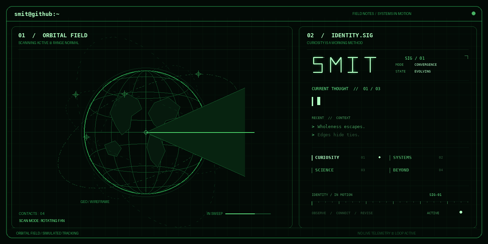

<!-- SMIT // personal systems console -->

<!-- <p align="center">
  
</p> -->

<p align="center">
  
</p>

<p align="center">
  <code>user@smit:~$ whoami</code><br>
  <samp>CSE student · builder · perpetual investigator</samp>
</p>

<p align="center">
  
</p>

---

## `// about`

I like understanding how things work — and then going a little deeper than I probably needed to.

I'm drawn to the space between **systems, software, security, and engineering**. I learn by building, testing assumptions, finding the edge cases, and rebuilding when the first version isn't enough.

I care about becoming **capable, not just qualified**.

Not chasing a perfect path. Just trying to make mine interesting.

Still figuring things out. Still building. Still becoming.

**— Smit**

## `// current_interests`

<table>
  <tr>
    <td width="50%" valign="top">
      <strong>Systems & Linux</strong><br>
      <sub>What happens beneath the interface: processes, tooling, and the operating system.</sub>
    </td>
    <td width="50%" valign="top">
      <strong>Security</strong><br>
      <sub>Mapping attack surfaces, testing assumptions, and understanding failure modes.</sub>
    </td>
  </tr>
  <tr>
    <td width="50%" valign="top">
      <strong>AI & experimentation</strong><br>
      <sub>Exploring models, local tooling, and the practical limits of available hardware.</sub>
    </td>
    <td width="50%" valign="top">
      <strong>Engineering systems</strong><br>
      <sub>Connecting software, telemetry, and physical-system behaviour.</sub>
    </td>
  </tr>
</table>

<p align="center">
  
</p>

## `// selected_work`

### [SIH-UAV-twin](https://github.com/smit-04/SIH-UAV-twin)

**Engine digital-twin exploration for UAV health monitoring.**

An ongoing project focused on a digital-twin workflow for aero-piston engine monitoring, with the Rotax 914 as the reference engine. The broader problem space includes telemetry, engine-state modelling, health monitoring, and fault prediction.

<sub>Repository: <a href="https://github.com/smit-04/SIH-UAV-twin">smit-04/SIH-UAV-twin ↗</a></sub>

> More projects will appear here when there's something concrete to show—not just a repository to fill a slot.

## `// working_method`

```text
observe
  └─ understand the system
       └─ model the problem
            └─ test the assumptions
                 └─ build, measure, refine
```

I prefer understanding why something works over stopping at the fact that it works.

## `// github_telemetry`

<p align="center">
  
  
</p>

<p align="center">
  <sub><code>status: building</code> &nbsp;·&nbsp; <code>mode: curious</code> &nbsp;·&nbsp; <code>mission: understand more than yesterday</code></sub>
</p>

<p align="center">
  
</p>
